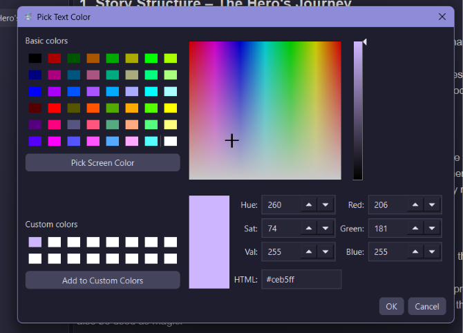
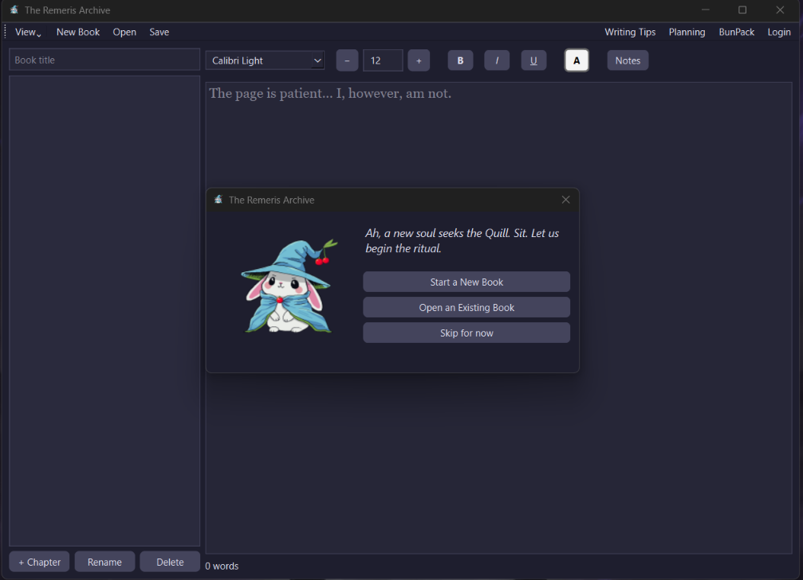
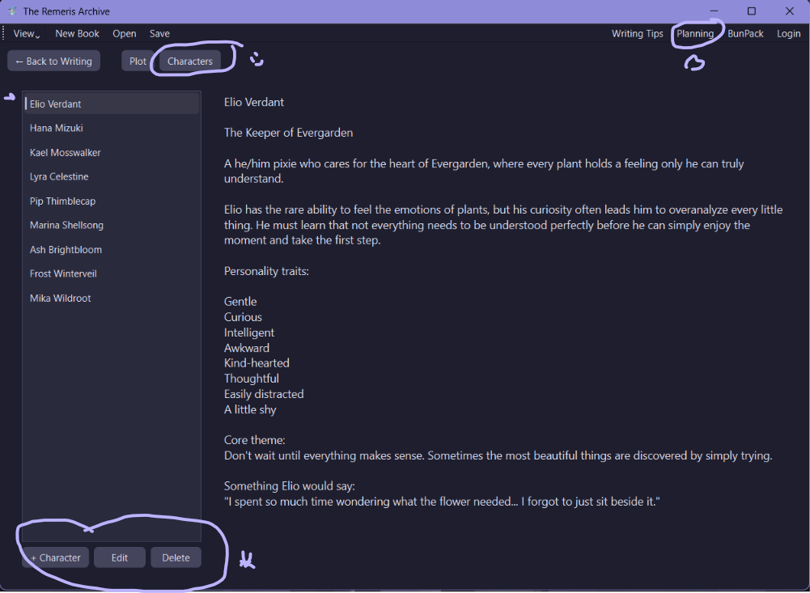
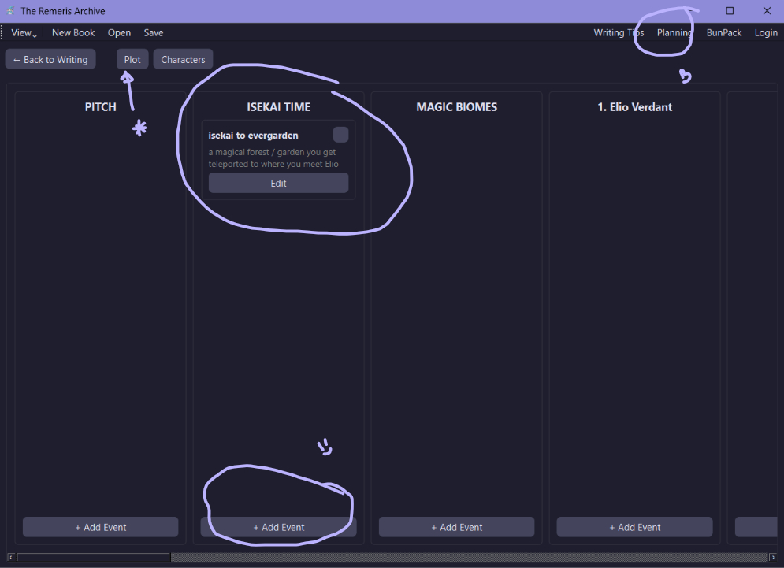
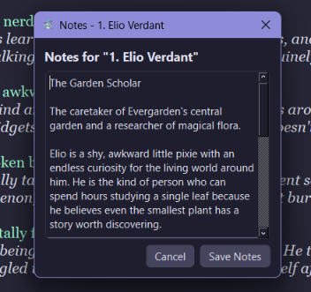
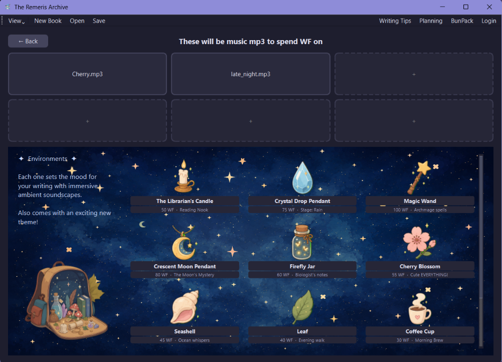
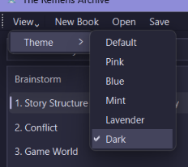

# The Remeris Archive

> The Remeris Archive is a creative writing space designed for storytellers. Write, organize, and develop your ideas in a focused environment built for imagination. Whether you create novels, short stories, journals, or entire worlds, grow your stories alongside a little mage bunny companion.

**[Download for Windows](https://github.com/MorganCherry/The_Remeris_Archive/releases/latest)** · **[View Releases](https://github.com/MorganCherry/The_Remeris_Archive/releases)** · **[View Source](https://github.com/MorganCherry/The_Remeris_Archive)**

---

## Table of Contents

  
Table of Contents

  <ol>
    <li><a href="#about-the-project">About The Project</a></li>
    <li><a href="#features">Features</a></li>
    <li>
      <a href="#functionalities">Functionalities</a>
      <ul>
        <li><a href="#text-editor">Text Editor</a></li>
        <li><a href="#character-planning">Character Planning</a></li>
        <li><a href="#plot-planning">Plot Planning</a></li>
        <li><a href="#chapter-notes">Chapter Notes</a></li>
        <li><a href="#bunpack">BunPack</a></li>
        <li><a href="#themes--appearance">Themes &amp; Appearance</a></li>
      </ul>
    </li>
    <li><a href="#download">Download</a></li>
    <li><a href="#design">Design</a></li>
    <li><a href="#roadmap-and-bugfixes">Roadmap and Bugfixes</a></li>
    <li><a href="#releases">Releases</a></li>
    <li><a href="#contact">Contact</a></li>
  </ol>

---

<!-- ABOUT THE PROJECT -->
## About The Project

The Remeris Archive is a desktop creative writing application designed to give writers a dedicated place to write, plan, and organize their stories.

Writing is more than just the final manuscript. Characters need to be developed, plots need to be planned, chapters need to be organized, and countless small ideas and reminders need somewhere to go.

The Remeris Archive brings these parts of the writing process together in one application.

(<a href="#readme-top">back to top</a>)

---

## Features

- Dedicated text editor
- Character planning
- Plot planning
- Chapter organization
- Chapter-specific notes
- Custom text colors
- Persistent custom colors
- Multiple application themes
- Music and themes through BunPack
- Automatic saving

(<a href="#readme-top">back to top</a>)

---

## Functionalities

The Remeris Archive is built around different parts of the writing process, from writing the actual story to planning characters, organizing plot progression, and keeping quick notes.

### Text Editor

The main window is where the actual writing happens.

The editor includes common formatting options such as **bold, italic, underline, font selection, and font size**, along with a large selection of text colors. Custom colors can also be created and saved for reuse, even after closing the application.

Chapters can be added, renamed, and deleted directly from the editor. The current chapter can also be saved manually, while the Archive automatically saves your work every few seconds.
Chapters can also be reordered at any time, so you can write out of order, skip chapters, or add new ones later without having to rebuild your story structure.

(<a href="#readme-top">back to top</a>)

---

### Character Planning

The Character Planning section keeps your characters organized in one place.

The left side contains all existing characters, with options to **add, edit, or delete** them. Selecting a character displays everything you have written about them on the right.

(<a href="#readme-top">back to top</a>)

---

### Plot Planning

The Plot Planning section allows you to build the progression of your story around its chapters.

Your chapters are displayed alongside the plot progression, allowing you to add individual events using **+ Add Event** and build the story's progression as you go.

(<a href="#readme-top">back to top</a>)

---

### Chapter Notes

Not everything belongs in the actual story.

Chapter Notes provide a place for quick reminders, temporary ideas, research, references, or other information you want to keep while working on a chapter.

Instead of putting research or development notes into the manuscript itself, they can stay attached to the chapter without becoming part of the story.

(<a href="#readme-top">back to top</a>)

---

### BunPack

BunPack is the store of the Archive, where additional content such as **music and themes** can be found and used in the application. Themes are built around the theme of each unlocked Keepsake. Each theme includes a matching color palette and visual assets, with some Keepsakes also featuring their own soundtrack and ambient sounds. Together, these options let you customize the Archive and make it your own.

(<a href="#readme-top">back to top</a>)

---

### Themes & Appearance

The Archive can be customized through the **View** menu.

Multiple themes and color schemes are available for changing the appearance of the application.

(<a href="#readme-top">back to top</a>)

---

## Download

You don't need Python, an IDE, or a development setup to use The Remeris Archive.

### Windows

1. Open the [latest release](https://github.com/MorganCherry/The_Remeris_Archive/releases/latest).
2. Scroll down to **Assets**.
3. Download the `.exe` file.
4. Run the application.
5. Start writing.

The current release is a **pre-release**, so some bugs and unfinished features are to be expected.

> Windows may display a security warning when running the application because the executable is not yet widely recognized.
>
> If Windows displays the "Windows protected your PC" message, select **More info** and then **Run anyway** if you trust the application.

(<a href="#readme-top">back to top</a>)

---

## Design

The Remeris Archive is designed around the idea of a personal archive for writers.

The interface combines a fantasy-inspired aesthetic with a practical writing environment. The goal is to make writing and organizing ideas feel more personal than using a generic text editor.

At the center of the Archive is **Remeris Jr., the Bun Mage**.

Remeris is the personality behind the Archive: a small, confident mage bunny who has apparently decided that mortals have suffered enough from terrible text editors.

He may or may not approve of your writing.

(<a href="#readme-top">back to top</a>)

---

## Roadmap and Bugfixes

The Remeris Archive is an ongoing project.

### Completed

- [x] Main text editor
- [x] Text formatting
- [x] Custom text colors
- [x] Persistent custom colors
- [x] Chapter creation
- [x] Chapter renaming
- [x] Chapter deletion
- [x] Automatic saving
- [x] Character planning
- [x] Plot planning
- [x] Chapter notes
- [x] Application themes
- [x] BunPack

### Planned

- [ ] Pictures in your writing — Add pictures directly to your chapters.
- [ ] Better bullet points — Add easier bullet point writing and indentation.
- [ ] More atmosphere — Add music, ambient sounds, environments, and improved themes.
- [ ] More Wizard Bunny — Add more Wizard Bunny visuals, reactions, and personality to the Archive.
- [ ] Better planning — Make plot events easier to move around and character information easier to edit.
- [ ] Improved Writing Tips & BunPack — Make the wizard bunny guide you through writing tips and polish the BunPack experience.
- [ ] Ink Quill & XP system — Improve progression and make unlocking things feel more rewarding.

(<a href="#readme-top">back to top</a>)

---

## Releases

### v0.1.0-beta

The first public beta release of The Remeris Archive.

This release contains the foundation of the application and its core writing and planning features.

It is still a work in progress, so expect some rough edges and bugs.

For the full release notes, see the [v0.1.0-beta release](https://github.com/MorganCherry/The_Remeris_Archive/releases/tag/v0.1.0-beta).

(<a href="#readme-top">back to top</a>)

---

## Contact

**Morgan Atmodimedjo**

[Project Repository](https://github.com/MorganCherry/The_Remeris_Archive)

---

  <a href="#top">Back to top</a>

<!-- ACKNOWLEDGMENTS 
***Thanks a lot for the template of a fantastic looking read me!
***https://github.com/othneildrew/Best-README-Template/blob/main/README.md
-->
